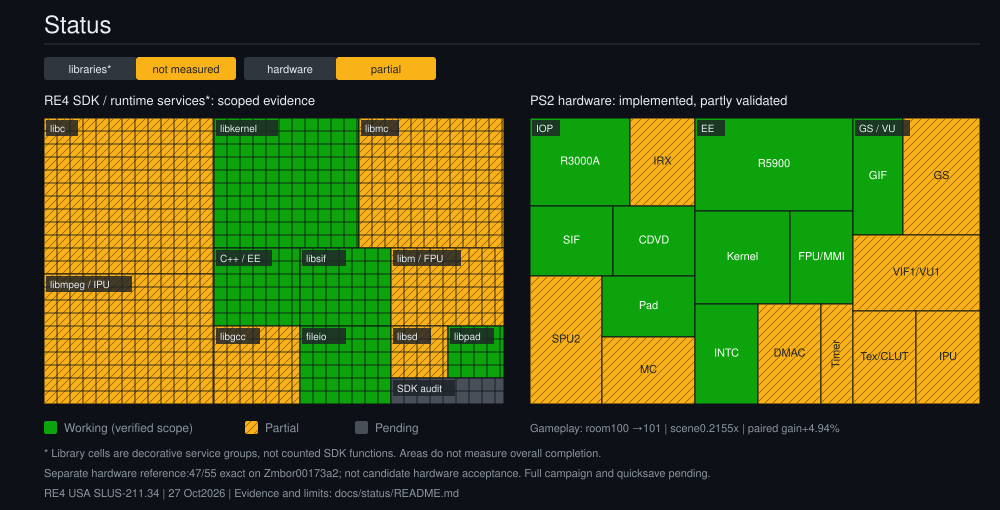

<div align="center">

# Project-4 — Resident Evil 4 Native Recompilation

**An experimental PS2-to-PC engineering project for Resident Evil 4 (USA), SLUS-211.34.**

Windows x64 · C++ / Python · PS2Recomp · Zmbor compatibility laboratory · paraLLEl-GS

[Progress map](docs/status/README.md) · [Tests](docs/testing/README.md) · [Documentation](docs/README.md) · [Source setup](docs/GITHUB_SETUP.md)

</div>

Project-4 statically recompiles the game's EE code to native C++ and supplies a runtime for PS2 hardware and system services. IOP and other device paths still use interpretation or emulation where applicable. This is an active compatibility project, not a finished release.

**Reviewed source-only distribution:** no game disc, BIOS, extracted executable, proprietary module, generated game code, runtime capture, executable package, or save data is included. Provide your own game data locally. Existing dependency licenses are retained.

## Current progress

[](docs/status/README.md)

Latest evidence: **27 October 2026**.

| Milestone | Verified scope |
|---|---|
| Boot, menus, new game and introductory sequences | Observed in isolated runs |
| Forest movement, aiming and shooting | Observed; backing ammunition checked |
| Room transition 0x100 → 0x101 | Real transition, then 677 stable observations |
| Inventory interaction | Observed historically; full visual equivalence still incomplete |
| Campaign save, exit, restart and reload | Verified on an earlier isolated runner/card |
| Latest VU helper-boundary candidate | Seven paired comparisons: median paired **+4.94%** in one fixed scene |
| Scene speed | Median **0.2058x → 0.2155x**; real time is 1.0x |
| Full campaign, later progression, broad combat | Not verified |
| Arbitrary-location quicksave | Not implemented |

The experimental candidate is separate from the accepted executable. Its gain does not imply campaign-wide performance or a package upgrade. VU flag coalescing, indexed retirement and coverage experiments that failed their gates remain rejected or disabled.

## Validation

- C++: **635/635** for both reference and candidate.
- VU: **3,200** full-state snapshots, 964/1,024-command workloads, budgets, continuation, queue state and GIF output compared.
- Lab Python: **104/104** in the latest complete supplemental run.
- Rendering: **37** matching guest-tagged RGBA frames; raw committed PCM prefix agreed, without speaker/AV-sync proof.
- Hardware reference: **47/55** exact on pinned **Zmbor 00173a2**, with eight known mismatches. This is separate from candidate-engine validation.
- Two full-suite invocations retained one failure each. Repaired framework tests and unchanged engine binaries form an aggregate gate; neither original invocation is described as fully passing.

See [exact results and limitations](docs/testing/RESULTS.md). Test counts are scoped evidence, not a completion percentage or a clean-clone build guarantee.

## Repository layout

```text
core/                         Reviewed public runtime/recompiler and native tests
ps2l/                         Project command-line tooling
tests/                        Project-4 Python tests
tools/                        Original diagnostic/build tools
profiles/                     Identity and pipeline configuration
integrations/                 Runtime adapters
dependencies/                 Existing public dependencies and license notices
compatibility/tools/          Reviewed laboratory orchestration and replay tools
compatibility/tests/          Laboratory test/harness sources; private fixtures excluded
compatibility/reference-tools/ Project-4 Python reference copy; BIOS helpers omitted
compatibility/lab/            Historical source build helpers; no binaries
docs/                         Documentation, reports, tests and editable SVG status map
```

**Publication exclusions after review:** duplicate engine/source archives, duplicated BIOS-analysis tools and source patch bundles are held locally and are not added by this update. Earlier copies in the existing public baseline are unchanged. Historical reports may refer to excluded local files. The full local archive is preserved separately; this branch is the reviewed publication subset.

## Getting started

Requirements for the local native toolchain: Windows x64, Python 3.10+, Visual Studio C++ build tools and Windows SDK, LLVM/clang-cl, CMake and Ninja. Some analysis tools have additional optional dependencies. Use an x64 developer shell for native builds.

```powershell
git -c core.longpaths=true clone https://github.com/m7kor/Project-4.git
cd Project-4
python -m pip install -r requirements-dev.txt
python -m ps2l status
```

Read [source setup](docs/GITHUB_SETUP.md), [build notes](docs/01-BUILD.md) and [test setup](docs/testing/README.md) before building. The source tree deliberately omits locally generated EE/native-module sources and captured VU tables. Generate those from your own inputs and configure dependency/build paths for your machine. **A fresh public native game build has not been validated.**

Original launch scripts expect a separately assembled local game package. No ready-to-play package is offered here. Keep original game data read-only and use separate test cards and build directories.

## Testing

All test/support sources included in this publication are indexed in [docs/testing/SOURCE_INDEX.md](docs/testing/SOURCE_INDEX.md). The existing lab groups are retained:

```text
test fast        test vu          test ee          test graphics
test audio       test hardware    test dma         test iop
test integration test full        test auto
```

These are groups in the Python lab runner, not installed shell commands. Their command syntax and required local inputs are documented in the [unified guide](docs/testing/README.md). Missing private fixtures are not successful tests. Do not rewrite hardware expectations to manufacture a pass.

## Next engineering targets

1. Lossless controller recording for conflicting same-tick events and repeatable room navigation.
2. Low-overhead VU profiling of the new candidate before another optimization.
3. More post-room-transition combat, inventory, event and streaming acceptance.
4. New campaign save/reload acceptance on isolated cards for each promoted build.
5. Audio underrun attribution, speaker output, AV synchronization and frame pacing.
6. Broader independent hardware comparison and portable public build setup.

## Documentation and provenance

The main README and new navigation/status/testing guides are in English. Historical engineering reports retain their original language and revision-specific claims. [The documentation index](docs/README.md) separates current evidence from older investigations. [Publication notes](docs/publication/README.md) explain what was included from the two local workspaces and what remains private.

## Credits and licenses

- [PS2Recomp](https://github.com/ran-j/PS2Recomp): original recompiler/runtime; see [core/LICENSE](core/LICENSE).
- [Zmbor](https://github.com/m7kor/Zmbor): reference engine and hardware-regression engineering.
- paraLLEl-GS, PCSX2, Tracy and other included dependencies: their existing notices and licenses remain with their sources.
- [God of War Recomp](https://github.com/KIexster/god-of-war-recomp): inspiration for clear component-status presentation; its performance and implementation claims do not apply to RE4.

Resident Evil 4 belongs to its respective rights holders. This project is unaffiliated with them. No rights to game data or BIOS are granted by the source licenses.
